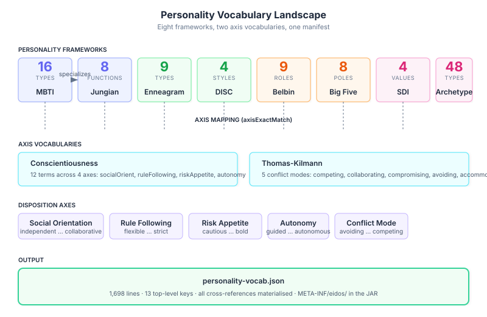
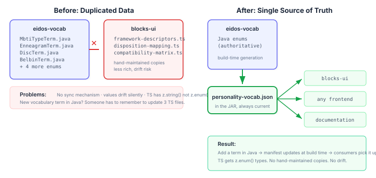
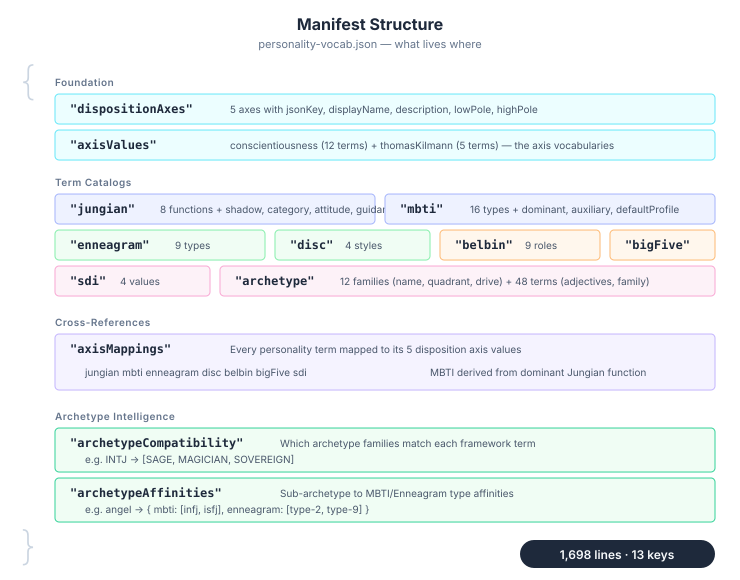
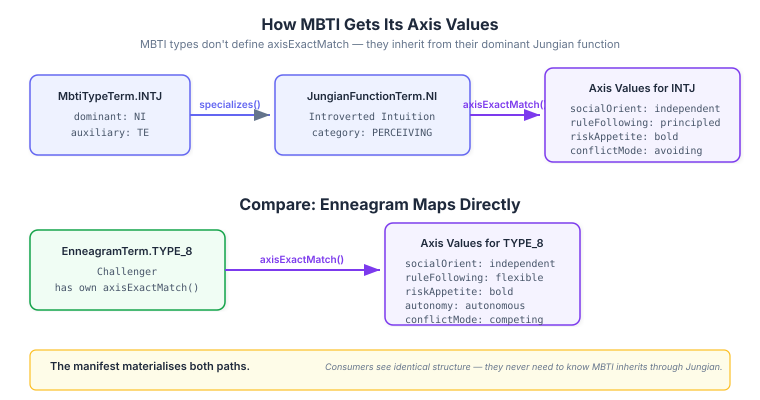
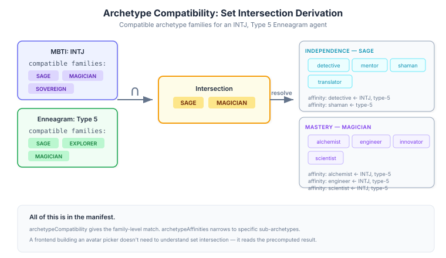

# The Manifest That Ends the Copies

Eidos has a rich personality vocabulary system — eight frameworks, each implemented as a Java enum with typed cross-references, axis mappings, shadow pairs, and compatibility matrices. MBTI types specialise Jungian cognitive functions. Enneagram terms map to five disposition axes. Forty-eight archetypes nest into twelve families across four motivation quadrants. The type system enforces all of it at compile time.

The problem: none of that knowledge was accessible outside Java.



## The duplication tax

The blocks-ui frontend maintains its own copies of the personality data in three TypeScript files: `framework-descriptors.ts`, `disposition-mapping.ts`, and `compatibility-matrix.ts`. Hand-maintained. Less rich than the Java source. No axis mappings. No archetype affinities. And every time I add a term or fix a label in the Java enum, someone has to remember to update the TypeScript copies. Nobody ever does, because there is no mechanism to tell them.

The `PersonalityProfile` interface in blocks-ui uses `string` for every personality facet. Not `"INTJ" | "INTP" | ...` — plain `string`. Zod validates with `z.string()`, not `z.enum()`. A typo in a profile config passes validation silently.



This is the familiar "two sources of truth" failure mode, except it's worse here because the Java source has structure the TypeScript copies don't even attempt to capture. The axis mappings — which personality term maps to which disposition axis value — exist only in Java `axisExactMatch()` method overrides. The archetype compatibility matrices live in a static initialiser block. None of it was serialised.

## What the manifest captures

The generator walks every vocabulary enum at build time and produces a single `personality-vocab.json` in the JAR at `META-INF/eidos/`. Thirteen top-level keys. Every cross-reference materialised as plain data.



The interesting design question was axis mappings for MBTI types. MBTI doesn't override `axisExactMatch()` directly — it inherits through the dominant Jungian function. An INTJ's axis values come from Introverted Intuition (Ni), not from the INTJ type itself. The generator follows the `specializes()` chain and records the result. A frontend consumer sees identical structure for all seven frameworks. It never needs to understand the Jungian specialisation hierarchy.



```java
private static Map<String, Map<String, String>> buildMbtiAxisMap() {
    var result = new LinkedHashMap<String, Map<String, String>>();
    for (var type : MbtiTypeTerm.values()) {
        var dominant = (JungianFunctionTerm) type.specializes().get(0);
        var mapping = extractAxisMapping(dominant);
        if (!mapping.isEmpty()) {
            result.put(type.value(), mapping);
        }
    }
    return result;
}
```

The code is direct: for each MBTI type, get the dominant function, extract its axis mapping, file it under the MBTI type's key. The hierarchy is resolved at generation time. The manifest is flat.

## Archetypes: the deep cross-reference

The archetype section was the most data-dense. Forty-eight sub-archetypes across twelve families, each with valid and invalid adjective lists. On top of that, compatibility matrices mapping every personality framework to archetype families, plus sub-archetype-level affinities for MBTI and Enneagram.



The compatibility data uses `ArchetypeCompatibility`'s public API — `compatibleFamilies()` and `subArchetypeAffinity()` — rather than reflecting into private fields. The generator iterates every framework-term combination and records the result. Not elegant, but correct, and the work happens once at build time.

The affinities are the part that matters most for a frontend avatar picker. "For an INTJ, Enneagram Type 5 agent, which sub-archetypes should we surface?" The manifest answers this directly: the intersection of MBTI-compatible and Enneagram-compatible families gives you SAGE and MAGICIAN, then the affinity map narrows further to detective, shaman, alchemist, engineer, scientist. A frontend can read this and present intelligent defaults without any personality theory in its codebase.

## The build-time pattern

The generator is a plain Java class with a `main()` method, wired into Maven's `prepare-package` phase via `exec-maven-plugin`. After compilation, before packaging. The output lands in `target/classes/META-INF/eidos/` and gets included in the JAR automatically.

I considered a Quarkus build extension, but this is one class producing one file. The exec-maven-plugin is the right tool. A build extension would add ceremonial complexity for no practical benefit.

Jackson `ObjectMapper` with `INDENT_OUTPUT` and `LinkedHashMap` for deterministic key ordering. The generated JSON is 1,698 lines, stable across builds (same input enums → same output).

## Validation

Seventeen tests exercise the generator's `generate()` method directly. They verify term counts match enum constants, MBTI default profiles normalise to 1.0, Jungian shadow pairs are symmetric, axis mappings are present for all seven frameworks, INTJ's mapping matches NI's mapping, and archetype affinities resolve correctly.

The tests don't parse the generated file — they call the same static method the generator calls. If an enum gains or loses a constant, a test fails. The manifest can't drift from the enums because it's produced from them.

## What this opens up

The downstream work is a follow-up issue in blocks-ui: replace the three hand-maintained TypeScript files with imports from the manifest, add `z.enum()` validation to `PersonalityProfile`, and wire the archetype compatibility data into the avatar picker. That's a different session and a different repo.

The more interesting possibility is documentation generation. The manifest contains every term's label, description, and cross-references. A static site generator could produce a personality framework reference page directly from the JSON — always current, never hand-written. The JSON shape was designed with that in mind: human-readable keys, stable ordering, aliases included.
