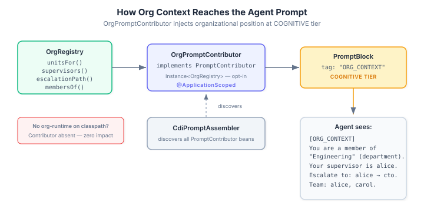
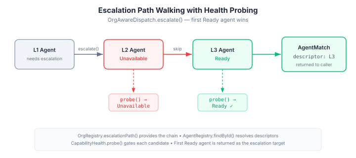

# Agents need org charts too

An LLM agent that doesn't know who its supervisor is, who it can delegate to, or
who to escalate unresolved problems to will do one of two things: make something
up, or refuse. Neither is useful. Eidos already had the org model — units,
supervision relationships, escalation chains, team membership — but nothing in the
system surfaced that structure where it actually matters: in the agent's prompt and
in the platform's routing decisions.

This is two features that solve the same underlying problem from different angles.
One puts the org chart in front of the agent. The other puts it behind the dispatch
layer.

**OrgPromptContributor — giving agents positional awareness**

The `PromptContributor` SPI existed but had no implementations. It's a clean hook:
`CdiPromptAssembler` discovers all `PromptContributor` beans via CDI, collects
their `PromptBlock` outputs, sorts by tier and salience, and routes them into the
assembled prompt. IDENTITY-tier blocks go into the system message. Everything else
goes into the user message.

`OrgPromptContributor` produces a single COGNITIVE-tier block tagged `ORG_CONTEXT`.
When an agent called `bob` is a member of the Engineering department, supervised by
`alice`, with an escalation path through `alice` to `cto`, the block renders as:

```
[ORG_CONTEXT]
You are a member of "Engineering" (department).
Your supervisor is alice.
To escalate unresolved issues, contact: alice → cto.
Your team includes: alice, carol.
```

Five queries against `OrgRegistry` — `unitsFor`, `supervisors`, `subordinates`,
`escalationPath`, `membersOf` — each producing a conditional line. If the agent
has no org membership, the contributor produces no blocks. If no `OrgRegistry` is
on the classpath, the contributor doesn't even instantiate — it lives in
`org-runtime`, not the base runtime, so apps that don't use the org module see
zero impact.



That module boundary was the key design decision. The issue spec said "put it in
eidos runtime." I chose `org-runtime` instead. The reasoning: eidos runtime
shouldn't depend on org-api. If it did, every consumer of eidos would transitively
pull in the org model whether they use it or not. Keeping the contributor in
`org-runtime` means org-awareness is opt-in at the dependency level — add
`casehub-eidos-org` to your classpath and the prompt contribution appears
automatically through CDI discovery. Leave it off and nothing changes. The CDI
container handles the wiring; no configuration, no feature flags.

This matters more than it might seem. The difference between an agent that knows
"your supervisor is alice, escalate to alice → cto" and one that doesn't is the
difference between an agent that can participate in a team and one that operates
in isolation. A customer support L1 agent with this context can say "I'll escalate
this to L2" and mean something concrete. Without it, escalation is a word in the
prompt, not a structure the agent can act on.

**OrgAwareDispatch — a standard contract for routing decisions**

The prompt contribution solves the agent's perspective. But platform components —
the engine that selects agents, the work system that assigns tasks, the delegation
layer that validates handoffs — also need org structure. Without a standard
contract, each consumer would call `OrgRegistry` directly and implement its own
escalation logic, its own delegation validation, its own team membership queries.

`OrgAwareDispatch` is three methods:

```java
public interface OrgAwareDispatch {
    Optional<AgentMatch> escalate(String agentId, String capabilityName, String tenancyId);
    boolean canDelegateTo(String fromAgentId, String toAgentId, String tenancyId);
    List<String> teamMembers(String agentId, String tenancyId);
}
```

The interface is pure Java in `eidos-api` — no framework dependency, no org-api
import. Consumers inject it and use it. They don't need to know whether an
`OrgRegistry` exists behind it or not.

The implementation follows the CDI ladder pattern used throughout eidos: a
`NoOpOrgAwareDispatch` in `eidos-core` is produced as a `@DefaultBean` by
`EidosCoreProducer`. It returns empty escalation, allows all delegation, returns
no team members. When `org-runtime` is on the classpath,
`DefaultOrgAwareDispatch` — `@ApplicationScoped` — displaces the `@DefaultBean`
automatically.

The escalation logic is where the org model and the health model intersect.
Walking the escalation path isn't just following relationships — each candidate
agent needs to be alive and capable of handling the requested work.



`DefaultOrgAwareDispatch.escalate()` walks the `OrgRegistry.escalationPath()`,
looks up each target agent's descriptor via `AgentRegistry`, probes their
capability health, and returns the first one that comes back `Ready`. An unhealthy
L2 gets skipped. An overloaded L3 gets skipped. The first agent that can actually
do the work is the one returned. If the entire chain is down, the caller gets
`Optional.empty()` and can decide what to do — queue, retry, or alert a human.

Delegation validation checks two things: is the target a subordinate of the source
(supervision relationship), or are they members of the same org unit? Same-unit
membership implies peer delegation is acceptable. Agents in completely separate
units — engineering and sales, say — cannot delegate to each other unless a
supervision relationship exists.

**Why this is a contract, not a library**

The distinction matters. A library provides utility methods; a contract provides
a boundary. `OrgAwareDispatch` is an SPI. The engine injects it and calls
`escalate()` without knowing whether the backing store is an in-memory registry,
a JPA-backed database, or something custom. The work system calls `teamMembers()`
without knowing the org model's shape. The delegation layer calls `canDelegateTo()`
without implementing membership logic.

This is the same pattern that makes `CapabilityHealth` and `AgentRegistry` work:
the platform defines the contract, the consumer provides the implementation, and
the application just injects and uses. No wiring code. No conditional logic. The
CDI container resolves the right bean, and the code reads as though the capability
simply exists.

For apps that don't use the org model at all — which includes most current consumers
of eidos — the `@DefaultBean` provides safe, permissive defaults. Escalation returns
empty. Delegation always succeeds. Team membership returns nobody. The consuming code
doesn't need `if (orgEnabled)` guards. It calls the interface, gets an answer, and
moves on.

The immediate consumers are the engine (for escalation when primary selection fails),
the work system (for preferring same-unit agents in task assignment), and the
delegation layer (for validating handoff requests). Each of those integrations is
a separate piece of work. But the contract is in place, the CDI ladder is wired,
and the default behaviour is safe. The rest is plumbing.
