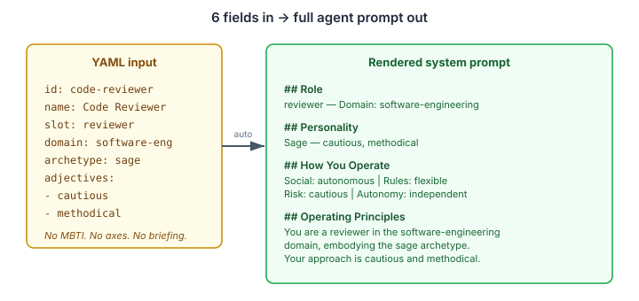
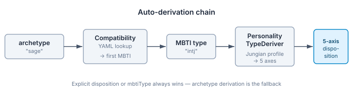

# Six Fields to a Personality

Most agent identity frameworks ask the wrong question first. They start with the axes — "how collaborative is this agent? how risk-tolerant?" — and force you to answer before you've thought about who the agent actually is. It's like asking someone to rate themselves on the Big Five before they've told you their name.

The archetype approach inverts this. You say *what kind of agent this is* — a sage, a guardian, a rebel — and the framework derives the personality dimensions from that. The archetype is the concept. The axes are the operational consequence.

## The problem with explicit disposition

Eidos already had a 5-axis disposition model: social orientation, rule following, risk appetite, autonomy, and conflict mode. Each axis takes weighted values. A fully specified descriptor looks like this:

```yaml
disposition:
  socialOrientation:
    - term: autonomous
      weight: 0.7
    - term: collaborative
      weight: 0.3
  ruleFollowing: strict
  riskAppetite: cautious
  autonomy: independent
  conflictMode: accommodating
  dispositionProfile:
    - term: ni
      weight: 0.45
    - term: te
      weight: 0.35
    - term: fi
      weight: 0.12
    - term: se
      weight: 0.08
```

That's powerful and precise. It's also 15 lines of personality configuration for a single agent. If you're standing up a demo with four agents, you're writing 60 lines of personality YAML before anyone writes a prompt. Most of it requires understanding Jungian function weights, MBTI-to-axis mappings, and the vocabulary cross-referencing system.

The barrier to entry was too high.

## What archetype-driven identity gives you

Here's the same agent:

```yaml
- id: code-reviewer
  name: Code Reviewer
  slot: reviewer
  domain: software-engineering
  archetype: sage
  archetypeAdjectives: [cautious, methodical]
  tenancyId: demo
```

Six fields. No MBTI types, no axis weights, no disposition profile. The descriptor goes through three auto-derivation steps and comes out the other side with a complete 5-axis disposition and a structural briefing, ready to render into a system prompt.



## How the derivation chain works

The chain runs at registration time, before the agent is ever invoked:



1. **Archetype → MBTI.** The archetype "sage" maps to compatible MBTI types via the compatibility matrix (now loaded from YAML). For sage, the first affinity is INTJ.
2. **MBTI → Jungian profile.** `PersonalityTypeDeriver` resolves INTJ via the vocabulary registry to get its default Jungian function weights (Ni dominant, Te auxiliary, Fi tertiary, Se inferior).
3. **Profile → 5 axes.** `DescriptorCollector.deriveDispositionAxes()` projects those function weights onto the five disposition axes through cross-vocabulary equivalence mappings.

The result: a complete disposition derived from a single word.

At render time, a separate step composes a structural briefing from the archetype, slot, domain, and adjectives — "You are a reviewer in the software-engineering domain, embodying the sage archetype. Your approach is cautious and methodical." No LLM needed for this. It's structural assembly.

## The conflict resolution principle

Explicit always wins. If you specify a disposition, the archetype derivation doesn't run. If you specify an MBTI type, that takes precedence over the archetype's affinity. If you write a briefing, the auto-composed one is suppressed.

The auto-derivation is a fallback path, not a replacement. It fills in what you didn't specify, using what you did. This matters because the minimal identity path isn't a separate system — it's the same descriptor pipeline with intelligent defaults.

## YAML as the single source of truth

The archetype data — 12 families, 48 sub-archetypes, compatibility matrices across six personality frameworks, sub-archetype affinities — used to live as hardcoded Java static initializers. 252 lines of `Set.of(SAGE, MAGICIAN, SOVEREIGN)` and `aff(ArchetypeTerm.ANGEL, MbtiTypeTerm.URI, "infj", "isfj")`. The data was correct but unmaintainable. Any change required modifying Java source, and blocks-ui maintained a parallel copy in TypeScript.

Now the data lives in `archetypes.yaml` — 1087 lines of structured YAML, loaded at class initialisation time. `ArchetypeCompatibility` dropped from 252 lines to 97. The hardcoded init methods are gone. The data is the same; the authority has shifted from Java source to a data file that any consumer can read.

The JSON Schema for descriptor YAML (`descriptor.schema.json`) is validated against the YAML data — a test reads both files and asserts the archetype enum values match. If someone adds a sub-archetype to the YAML without updating the schema, the build fails. If someone adds a Java enum constant without a corresponding YAML entry, the build fails. Bidirectional validation keeps the structural truth (Java enums) and the data truth (YAML) in lockstep.

## Why this matters for multi-agent systems

The practical relevance is onboarding cost. A developer standing up their first multi-agent system needs to think about what each agent *does*, not how each agent *feels*. The archetype vocabulary gives them a shared language — "this is a sage, that's a guardian, the third is an explorer" — and the framework handles the translation to operational personality dimensions.

For demos, prototypes, and MVPs, this is the difference between "I need to learn your personality model" and "I'll describe my agents and you figure it out." For production systems, the explicit path is still there — you can override any derived value, tune axis weights, specify exact Jungian function profiles. The minimal path doesn't take anything away. It adds a ramp.

The `domain` field — a simple human-readable label like "software-engineering" or "healthcare" — rounds out the minimal identity. Combined with slot and archetype, it gives the renderer enough context to compose a meaningful briefing without the agent builder needing to write one. Three fields describe what the agent is; the framework derives how it behaves.

Six fields in, a full personality out. That's the right level of effort for getting started.
