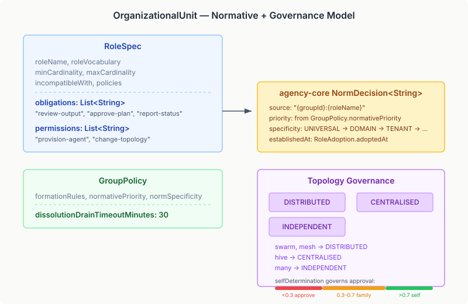

# Normative Teeth for Agent Societies

Two days ago I wrote about shipping the society model — the structural skeleton that lets agents form groups, adopt roles, and coordinate through topology-specific primitives. The skeleton works. Agents join groups, take on roles, leave when done. But if you ask "what must a coordinator actually *do*?" the model had no answer. Roles existed as empty labels with cardinality constraints. A coordinator was just a name attached to an agent count.

That gap matters more than it looks.

## Why Norms Are Not Optional

Most multi-agent frameworks treat role assignment as sufficient for coordination. Agent A is the "coordinator," so it coordinates. Agent B is a "worker," so it works. The framework routes messages by role label and hopes the agents figure out the rest.

This breaks as soon as you have cross-group obligations. An agent holds the coordinator role in two groups simultaneously. Both groups expect it to review output. One group processes fraud claims; the other handles routine onboarding. When the agent's capacity is exhausted, which group's review obligation takes priority?

Without normative identifiers on roles, the answer is arbitrary. With them, the normative reasoning framework resolves the conflict using the same strategies it uses for any norm conflict: priority, specificity, recency, escalation. The fraud group's `normativePriority` is lower (wins in ascending sort). Its `normSpecificity` is `CASE_TYPE` (more specific than the onboarding group's `TENANT`). The obligation `"review-output"` from the fraud group takes precedence — not because someone hardcoded a priority table, but because the norms compose through the same resolution chain that handles every other kind of normative conflict in the system.

## The Model Change

`RoleSpec` gains two new fields: `obligations` and `permissions`. Both are `List<String>` — opaque norm identifiers that agency-core's `NormDecision<String>` framework resolves at enforcement time.

```java
public record RoleSpec(
    String roleName,
    String roleVocabulary,
    int minCardinality,
    int maxCardinality,
    Set<String> incompatibleWith,
    List<RolePolicy> policies,
    List<String> obligations,    // what the role holder must do
    List<String> permissions     // what the role holder may do
) { ... }
```

I deliberately kept these as plain strings, not typed enums or capability references. The existing `RolePolicy(capabilityName, PolicyKind, expectations)` already handles capability-based role requirements — "can this agent fill the role?" The new fields handle a different question entirely: "once filling the role, what behavioural expectations bind the holder?" Different consumers, different concerns, different fields.

In YAML, a role now looks like this:

```yaml
roleSpecs:
  - roleName: coordinator
    obligations:
      - review-output
      - approve-plan
      - report-status
    permissions:
      - provision-agent
      - change-topology
    policies:
      - capabilityName: code-review
        kind: OBLIGATION
```

Capability policies and normative obligations coexist on the same role. The capability policy says the coordinator *must have* the `code-review` capability. The obligation says the coordinator *must perform* output review. One gates assignment; the other governs behaviour after assignment.

An important distinction: obligations are *standing categories of responsibility*, not tasks. `"review-output"` doesn't mean "review this specific output right now." It means "whenever output needs reviewing, that's your responsibility." Think job description, not to-do list. A coordinator has three to five of these — review output, approve plans, report status. They're stable and few. The individual tasks ("review PR #42", "approve the migration plan for case #789") flow through the engine's normal work dispatch. The obligation tells the engine who is responsible for that *category* of work; the task is a specific instantiation of it.



## Dissolution Needs a Clock

The second addition is smaller but equally load-bearing. When a group dissolves, in-flight work needs to drain before members are released. The design spec set a default of 30 minutes but left it hardcoded. I added `dissolutionDrainTimeoutMinutes` to `GroupPolicy` — a single `long` field.

The post-timeout action is deliberately *not* modeled. The spec says the specific response (force-reassign to the parent coordinator, escalate to human review, or force-dissolve with fault logging) is CBR-informed — the `SocietyLifecycleManager` decides based on the situation, not a declarative strategy enum. I could have added `DissolutionStrategy { FORCE_REASSIGN, ESCALATE, ABANDON }` and made it configurable. I didn't, because the spec is explicit that the right action depends on context the model can't capture. A strategy enum would be speculative design — it would exist for completeness, not because anyone would configure it. When the runtime is built and the lifecycle manager actually needs declarative strategy control, the field can be added without breaking changes.

## Topology Families and Self-Governance

The third addition is the most architecturally interesting. The society model's `selfDetermination` field governs how much autonomy a group has over structural changes. Medium selfDetermination (0.3–0.7) means the group can auto-approve topology transitions "within family" but needs external approval to cross family boundaries. A swarm transitioning to a mesh — both distributed coordination patterns — is a refinement. A swarm transitioning to a hive — from distributed to centralised — is a structural shift that changes authority relationships.

The model needed a classification to make this distinction. I had three options: a `TopologyFamily` enum, a `Set<String> allowedTopologyTransitions` on GroupPolicy, or vocabulary-driven classification through the existing VocabularyTerm system.

The set-based approach was the most flexible and the least right. Topology family is a *classification*, not a *policy*. Whether swarm and mesh are in the same family is intrinsic to what those terms mean — it doesn't change per group. Putting it on GroupPolicy would mean every group independently declaring which transitions are "within family," when the answer is the same for all of them.

The vocabulary-driven approach was architecturally cleanest long-term but premature — there's no topology vocabulary enum in eidos-vocab yet, and building one just for this classification would be over-engineering the initial delivery.

I went with a middle path: a `TopologyFamily` enum (DISTRIBUTED, CENTRALISED, INDEPENDENT) and a `TopologyFamilyClassifier` SPI — a functional interface that takes a topology string and returns `Optional<TopologyFamily>`. The default implementation maps the four well-known values:

```java
private static final Map<String, TopologyFamily> FAMILIES = Map.of(
    "swarm", TopologyFamily.DISTRIBUTED,
    "mesh",  TopologyFamily.DISTRIBUTED,
    "hive",  TopologyFamily.CENTRALISED,
    "many",  TopologyFamily.INDEPENDENT
);
```

Unknown topologies get `Optional.empty()` — the runtime treats them as cross-family, requiring approval for any transition. Conservative by default. If a domain app defines custom topologies and wants them classified, it provides its own `TopologyFamilyClassifier` implementation. The SPI is there; the vocabulary-driven path can be built on top of it later.

## The Deontic Gap in Multi-Agent Systems

There's a broader point worth making. The BDI (Belief-Desire-Intention) tradition that most agent frameworks draw from is fundamentally about individual agents. It gives you beliefs, goals, plans — the cognitive machinery for a single agent to reason about what to do. But the moment you have multiple agents that need to coordinate, you need something BDI doesn't provide: *deontic reasoning* — obligations, permissions, prohibitions that arise from social structure rather than individual intention.

MOISE+ recognised this in 2005. The OperA framework formalised it further. But most production multi-agent systems still treat coordination as message-passing with role labels. The result is that inter-agent obligations are either implicit in code (fragile, invisible) or managed by a central coordinator (which defeats the purpose of distributed organisation).

What we're building with eidos is a model where normative expectations are *declared on the organisational structure* and *enforced by a general-purpose reasoning framework*. The obligations on a `RoleSpec` aren't consumed by the society module — they're consumed by agency-core's normative reasoning engine, which handles conflict resolution, priority, and enforcement for all norm sources. The society module is just another source of norms, composing with case-level norms, tenant-level norms, and any other normative source the system accumulates.

This is the difference between "agents in a group" and "agents in a society." A group is a container. A society has norms.
