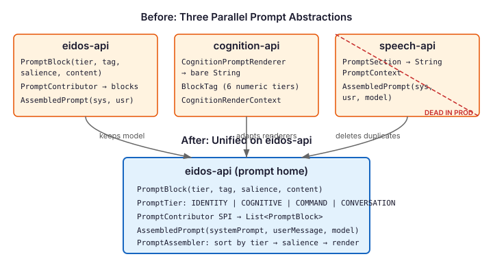

# One Model to Assemble Them

Three separate prompt assembly abstractions have been living across eidos, neocortex, and agency. Each grew independently to solve a local problem: eidos needed to render agent identity into LLM instructions, cognition needed to stitch together 22 cognitive sections in a specific order, and speech needed to format conversation history with model selection. The result was three different names for the same idea — and a brittle adapter in agency that had to bridge all of them.



The unification design picks eidos-api as the home. Not because it was first, but because its model is the richest: `PromptBlock(tier, tag, salience, content)` already carries the structural metadata the other two systems need. Cognition's `CognitionPromptRenderer` produces a bare `String` with no ordering metadata — the ordering lives in a separate `BlockTag` enum with numeric ordinals. Speech's `PromptSection` does the same without even that. Both force their callers to know the assembly order, rather than encoding it in the data.

## The tier sufficiency question

The design question that mattered most: does eidos need more `PromptTier` values to accommodate cognition's sub-ordering?

Cognition uses six tiers internally, numbered by convention: Identity at 100, State at 200, Knowledge at 300, Strategy at 400, Signals at 500, Stimulus at 900. The gaps between ordinals are intentional — room for future tiers without renumbering. At first glance, this looks like it needs six corresponding enum values in eidos.

It doesn't. The key insight is that `PromptBlock` already carries two orthogonal ordering axes: tier (which partition) and salience (where within the partition). Cognition's six sub-tiers all belong to a single partition — `COGNITIVE` — and their ordering maps directly to salience values:

| Cognition sub-tier | Salience | What it carries |
|---|---|---|
| State | 0.85 | Mood, drives, emotional state |
| Knowledge | 0.75 | What the agent knows right now |
| Strategy | 0.65 | Current reasoning approach |
| Signals | 0.55 | Observations from recent interactions |
| Stimulus | 0.15 | The immediate trigger |

The tag field (`"STATE"`, `"KNOWLEDGE"`, etc.) preserves semantic identity without coupling eidos to cognitive-specific concepts. A cognitive renderer produces `PromptBlock(COGNITIVE, "MOOD", 0.85f, content)` and the assembler orders it correctly — no special knowledge required.

This matters because the alternative — adding `STATE`, `KNOWLEDGE`, `STRATEGY` etc. as `PromptTier` values — would leak cognition's internal structure into eidos-api. Every consumer of eidos would see tier values that only make sense if you know what cognitive architecture looks like. The four existing tiers (`IDENTITY`, `COGNITIVE`, `COMMAND`, `CONVERSATION`) describe universal prompt structure. Sub-ordering within those tiers is the contributor's concern, expressed through salience.

## The model field

The other change is smaller but practically important. Speech-api's `AssembledPrompt` carries a `model` field — which LLM should process this prompt. Eidos's version didn't have it. When you're routing prompts to different models based on agent capabilities (a reasoning-heavy task goes to Opus, a fast lookup goes to Haiku), the assembled prompt needs to carry that signal.

```java
public record AssembledPrompt(
        String systemPrompt,
        String userMessage,
        String model
) {
    public AssembledPrompt(String systemPrompt, String userMessage) {
        this(systemPrompt, userMessage, null);
    }

    public AssembledPrompt withModel(String model) {
        return new AssembledPrompt(systemPrompt, userMessage, model);
    }
}
```

The two-arg constructor preserves backward compatibility — every existing caller continues to work without changes. The `withModel()` wither lets dispatch code attach the model selection after assembly, which is the right separation: assembly decides *what* the prompt says, dispatch decides *who* processes it.

## What this opens up

With eidos-api as the prompt representation home, the next two steps are concrete. Cognition-api adds eidos-api as a dependency and its 22 `CognitionPromptRenderer` implementations each become a `PromptContributor` producing typed `PromptBlock` values instead of bare strings. Agency deletes its duplicate types (`PromptSection`, `PromptContext`, its own `AssembledPrompt`) and the `CognitionAvatarAdapter` decorator that bridges them all simplifies from a three-way translator to a thin lifecycle wrapper.

The practical effect for anyone building on this platform: one SPI (`PromptContributor`), one data structure (`PromptBlock`), one assembler (`PromptAssembler`). Contribute blocks, let the assembler sort them. The cognitive ordering that currently requires inside knowledge of `BlockTag` ordinals becomes an implementation detail of the cognitive renderer — the rest of the system just sees blocks with salience values.
