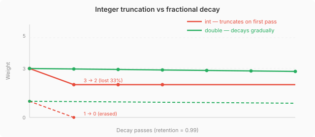

# Four Cracks in the Personality Layer

The neocortex personality evolution design review surfaced four bugs in eidos that don't hurt today but would compound silently once agents have persistent, evolving personality. Each is small in isolation. Together they'd produce a system where facet scores drift by truncation, keys collide by case, concurrent updates lose increments, and personality type oscillates between two arrangements forever. None of these would throw an exception. They'd just make the personality layer unreliable in ways that would be extremely difficult to diagnose.

## Free-form facet names

`AmpdFacet(String facet, int score)` validated only the score range. The facet name — which AMPD facet of the DSM-5 Alternative Model this score represents — was whatever string arrived from YAML or JSON deserialisation. `AmpdFacetShift`, by contrast, validated against a hardcoded set of 13 title-case names.

The practical failure: two authored spellings of the same facet ("anxiousness" and "Anxiousness") pass construction independently. Both end up in a descriptor's `ampdFacets` list. Any downstream code that keys by name — an evolved-facet write, an admin edit, a merge — either appends a duplicate or misses the existing entry. The bridge code in neocortex was already title-casing on read as a workaround, but that just masked the problem.

The fix is a single canonical authority. `AmpdFacets` owns the 13 title-case names and a `canonicalise()` method that does case-insensitive, whitespace-normalised lookup. Both `AmpdFacet` and `AmpdFacetShift` call it in their compact constructors. `new AmpdFacet("anxiousness", 40).facet()` returns `"Anxiousness"`. `new AmpdFacet("Anxiety", 40)` throws. And `AgentDisposition` now rejects duplicate canonical facets.

## Integer truncation on decay

`DispositionSignalStore.activationCounts()` returned `Map<String, Integer>`. The JPA store's decay method computed `e.count = (int) (e.count * decayFactor)`. Every single decay pass truncated.



A count of 3 decayed by 0.99 becomes 2 — a 33% loss from what should have been a 1% reduction. A count of 1 decayed by any factor below 1.0 becomes 0 immediately. The in-memory store had the same bug. Decay strength depended on count magnitude rather than on the configured retention, and low-count functions — which are precisely the functions you want to watch grow — vanished instantly.

Neocortex works around this by applying decay only on a coarse reflection grid (default 24h), which limits the damage. But even on that grid, the truncation biases low-count functions toward zero faster than the configured retention factor says they should go.

The fix: store as `double` throughout. `activationCounts()` returns `Map<String, Double>`. The JPA column is `DOUBLE PRECISION`. No truncation, no workaround needed. `ValenceCounts` still rounds to int in its bridge method — that's fine for display, not for computation.

## Signal store race conditions

The JPA `recordActivation` did a find-then-update: read the entity, increment, let the flush write it back. Two concurrent activations on the same function could both read count 5, both write 6. One increment lost, silently.

The in-memory store was better (it used `AtomicInteger.incrementAndGet`) but had its own problems. The key was string concatenation (`agentId + ":" + tenancyId`), which is fragile if either value contains a colon. `decay` used `replaceAll` followed by `removeIf` — two non-atomic operations that could race with a concurrent `recordActivation`. And `clear` used `store.remove(key)`, which could race with `computeIfAbsent` on the same key: the activation thread gets the inner map, clear removes the outer entry, the activation writes to a detached map.

The JPA fix: atomic upsert via `UPDATE ... SET weight = weight + 1 WHERE id = :id`, falling back to INSERT on zero rows, with a retry on unique constraint violation. `REQUIRES_NEW` transaction so a signal-store failure can't poison a caller's transaction. Decay uses bulk `UPDATE ... SET weight = weight * :factor` and `DELETE ... WHERE weight <= 0` — no entity reads, no managed-entity flush.

The in-memory fix: record key `StoreKey(agentId, tenancyId)` instead of string concatenation. `compute()` per-key for decay (atomic multiply-or-remove). `computeIfPresent` returning null for `clear` (atomic with respect to `computeIfAbsent`).

## Swap dead zone

The DOMINANT_AUXILIARY_SWAP probe condition compared the auxiliary's *effective* weight against the dominant's *base* weight:

```java
if (effective.getOrDefault(auxiliary.term(), 0.0) >= dominant.weight()) { ... }
```

This creates a dead zone. With balanced input (both functions activated equally), the auxiliary's effective weight can creep above the dominant's base weight of 0.35, triggering a swap. After the swap rewrites the profile (new dominant at 0.35, new auxiliary at 0.25), the same balanced input rebuilds the same situation in reverse. The old dominant, now auxiliary, creeps above 0.35 and triggers a swap back. This oscillation never stops and never throws — it just burns transition budget.

The dead zone is a fixed count difference (about 5 at the default delta of 0.06), so its width relative to total volume narrows as traffic grows. But it never closes, and balanced, busy input sits in it permanently.

The fix is hysteresis. The swap condition now compares effective-to-effective with a configurable margin:

```java
if (effective.getOrDefault(auxiliary.term(), 0.0)
        >= effective.getOrDefault(dominant.term(), 0.0) + swapMargin) { ... }
```

This eliminates oscillation by construction: `a >= b + m` and `b >= a + m` cannot both hold for any positive margin. The default margin is 0.03 (3 percentage points), configurable per tenant via `SwapMarginPreference`. A property test exhaustively verifies that no count pair `(d, a)` in `[0..20]` triggers the swap in both the original and swapped arrangement.

## Why this batch matters

None of these bugs would have surfaced in the current system. There are no production deployments of eidos yet. The signal stores have no real traffic. JPAF personality evolution is not yet wired end-to-end.

But neocortex is about to wire it. The personality evolution design that prompted these fixes assumes that facet keys are stable, that decay is faithful to its retention factor, that concurrent activations produce exact counts, and that probe results are stable under sustained input. Each of these assumptions was false. Now they hold.
