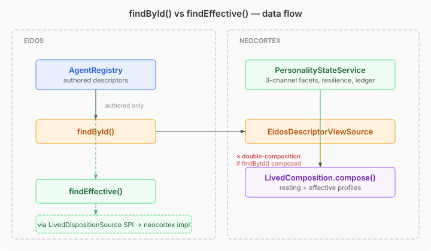

# The Store That Shouldn't Store

`DispositionProfileStore` has one implementation: `NoOpDispositionProfileStore`. It does nothing. Every personality evolution that eidos computes — every JPAF type transition, every cognitive function reweighting — gets discarded into that void. The neocortex orchestrator calls `profileStore.update()` after a successful evolution tick, and the result vanishes.

The issue seemed straightforward. Wire a real `DispositionProfileStore` backed by `AgentRegistry`. Read the descriptor, rebuild the disposition with the new values, call `register`. Same pattern as `updateGoalLifecycleState`. Add a facet write method. Add concurrency protection. Ship it.

I got as far as designing the persistence layer before the problems started showing up.

## The boot-time overwrite

`AgentDescriptorBootstrap` runs at startup. It collects every descriptor from YAML registrars and annotation processors, derives archetypes and disposition axes, then calls `registry.register()` for each one. The JPA registry's `register` is delete-and-insert — a wholesale replacement.

So any evolved disposition written to the registry during runtime gets overwritten on the next restart with the authored YAML values. Neocortex re-reads the descriptor on every cognition tick to rebase `EffectiveCognitiveDefaults`. After a restart, every evolved agent snaps back to its authored personality.

The obvious fix is to separate authored from evolved disposition. Store them independently. Compose at read time. I designed an `EvolvedDisposition` record — holds the evolved `dispositionProfile` and `ampdFacets` — with a separate persistence layer and composition inside `findById()`.

## The double-composition problem

Neocortex already solved this.

Its architecture has three layers: `DescriptorViewSource` reads the authored descriptor from eidos. `PersonalityStateService` holds the evolved state — facet displacements across three channels (permanent homeOffset, transient displacement, confirmed promotion), resilience, exposure, reflection ledger, reversal tracking. `EffectiveCognitiveDefaults` composes both via `LivedComposition.compose()`, producing resting and effective profiles.

If `findById()` returns composed values, then `EidosDescriptorViewSource` feeds an already-composed descriptor to `EffectiveCognitiveDefaults`, which calls `LivedComposition.compose()` on top. Home offsets applied twice. Disposition profile overlaid twice. Facet scores corrupted.

And the lossy projection problem: neocortex's per-facet state is richer than anything a simple eidos record could hold. Three displacement channels, resilience state, a reflection ledger with pending evolution and reversal streaks. An `EvolvedDisposition` record in eidos would be a projection that discards the channels neocortex actually computes.



## The right SPI is a bridge

The fix was to stop thinking about storage and start thinking about queries. Neocortex already has the persistence. It already has the composition. It already has the boot-overwrite protection — `LivedComposition.fingerprint()` creates a SHA-256 of the authored profile and discards the lived profile if the authored baseline changes.

What eidos consumers outside neocortex need is not another store. It's a way to ask: "what does this agent's personality look like right now, with evolution factored in?"

`LivedDispositionSource` is a `@FunctionalInterface` with one method:

```java
AgentDisposition resolveEffective(
    String agentId, String tenancyId,
    AgentDisposition authored);
```

The authored disposition goes in as a parameter. No callback to the registry. No circular dependency. The implementation is a pure function over `PersonalityStateService` state plus the authored input. The NoOp — which is all eidos ships — returns `authored` unchanged.

`AgentRegistry` gets a `findEffective()` method. The default delegates to `findById()`. The CDI implementations compose via `Instance<LivedDispositionSource>`. `findById()` stays authored-only. `EidosDescriptorViewSource` continues getting clean values. No double-composition.

## The broader pattern

The initial instinct was to build persistence in eidos because that's where the SPI lives. But the SPI's location in the dependency graph doesn't determine where the state belongs. When a downstream module has already solved the hard problem — three-channel facet model, fingerprint-based baseline detection, version-checked cache invalidation — the right SPI is a read-only bridge that surfaces existing computation, not a parallel implementation that fights with it.

`DispositionProfileStore` stays a NoOp in eidos. The store that shouldn't store.
