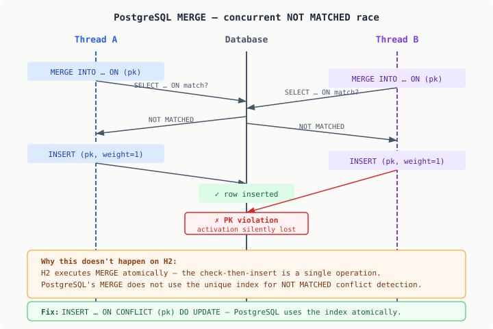

# The SQL That Only Races in Production

SQL `MERGE` looks like a solved problem. One statement, atomic upsert — if the row exists, update it; if not, insert it. That is exactly what it does on H2, the in-memory database that runs every test in the eidos test suite. And it is not quite what it does on PostgreSQL.

The gap is narrow enough that you can ship it, run a full test suite against it, and never see it fail. But put two concurrent requests against the same agent in production, and one of them silently loses data.

## The setup

Eidos has two JPA signal stores that track per-agent state over time. `JpaDispositionSignalStore` records cognitive function activations — how often an agent exercises a particular thinking style. `JpaBehavioralSignalStore` accumulates behavioral signals — declines, successes, compliance and violation events — with per-signal TTL-based expiry.

Both stores need an upsert: if a row exists for this `(agentId, tenancyId, key)`, increment the counter; if not, insert a new row with count 1. The previous session had already moved the disposition store from an update-then-insert two-statement pattern to SQL standard `MERGE`:

```sql
MERGE INTO disposition_signal AS ds
USING (VALUES (:agentId, :tenancyId, :functionTerm))
  AS src(agent_id, tenancy_id, function_term)
ON ds.agent_id = src.agent_id
  AND ds.tenancy_id = src.tenancy_id
  AND ds.function_term = src.function_term
WHEN MATCHED THEN
  UPDATE SET weight = ds.weight + 1
WHEN NOT MATCHED THEN
  INSERT (agent_id, tenancy_id, function_term, weight)
  VALUES (src.agent_id, src.tenancy_id, src.function_term, 1.0)
```

H2 runs this atomically. Every test passed. I filed #249 as a follow-up because I knew the PostgreSQL story was different.

## The race

PostgreSQL's `MERGE` does not use the unique index for conflict detection on the NOT MATCHED path. Two threads that both see no existing row will both attempt the INSERT. One succeeds; the other hits a primary key violation. The activation is silently lost.



The critical thing is that H2's MERGE is genuinely atomic — the check and the insert are one operation. So every test in the suite exercises the MERGE path, sees correct results, and gives you full confidence in SQL that will race under concurrent load on a different database.

## The fix

PostgreSQL has its own atomic upsert idiom: `INSERT ... ON CONFLICT DO UPDATE`. Unlike MERGE, it uses the unique index to detect conflicts atomically:

```sql
INSERT INTO disposition_signal
  (agent_id, tenancy_id, function_term, weight)
VALUES (:agentId, :tenancyId, :functionTerm, 1.0)
ON CONFLICT (agent_id, tenancy_id, function_term)
DO UPDATE SET weight = disposition_signal.weight + 1
```

Both paths — insert and conflict-update — are resolved in a single index operation. No window for a second thread to slip in.

The question was how to select between these two SQL variants at runtime. The issue listed three options: separate store implementations per dialect gated by `@IfBuildProperty`, runtime dialect detection, and Hibernate's `@SQLInsert`. I went with runtime detection — the SQL difference is a string constant, not a behavioural difference. Doubling the class count for a one-line change would be over-engineering.

`JpaDialect.isPostgres(EntityManager)` checks the JDBC URL from the EntityManagerFactory properties. Each store calls it at `@PostConstruct` and selects the appropriate SQL. The whole dialect utility is seven lines of logic.

## Extending to both stores

The behavioral signal store had a different race. It used JPA's find-then-persist pattern:

```java
var existing = em.find(BehavioralSignalEntity.class, id);
if (existing != null) {
    existing.signalCount++;
} else {
    em.persist(new BehavioralSignalEntity(...));
}
```

Same class of problem: two threads both find nothing, both persist, PK violation. The fix was the same shape — replace the JPA managed-entity pattern with native SQL upsert, dialect-selected. The H2 path uses MERGE (matching the disposition store pattern); the PostgreSQL path uses INSERT ON CONFLICT.

One thing worth noting: after switching to native SQL, the method adds `em.flush(); em.clear()` to evict the persistence context. Without this, subsequent `em.find()` calls in `count()` could return stale cached state from before the native SQL ran. The disposition store doesn't need this because `recordActivation()` is `@Transactional(TxType.REQUIRES_NEW)` — it commits its own transaction and the persistence context is scoped to it.

## What the tests found (and didn't)

I added `JpaDispositionSignalStoreTest` — nine tests covering insert, increment, multi-term weights, decay, clear, and agent/tenancy isolation. The first run failed immediately. Not because of a SQL problem — because `recordActivation()` is `REQUIRES_NEW`. Each call gets its own transaction that commits independently. `@TestTransaction`'s rollback at the end of the test method has no effect on data written inside a `REQUIRES_NEW` transaction. Data accumulated across tests.

The fix was straightforward: drop `@TestTransaction` and add a `@BeforeEach` method that truncates the table with native SQL. It is worth noting that the behavioral signal store tests use `@TestTransaction` correctly — `record()` is `@Transactional` (REQUIRED), so it joins the test's transaction and rollback works.

All 627 runtime tests pass. What they cannot verify is whether the PostgreSQL ON CONFLICT SQL is syntactically correct or semantically right under concurrent load — every test hits H2. This is the fundamental tension: the race only exists on a database the tests don't use.

## Why this matters beyond eidos

Test-database fidelity is an underappreciated source of production bugs. H2 with `MODE=PostgreSQL` closes most of the gap — it handles PostgreSQL's type coercions, most SQL syntax, and schema DDL. But MERGE atomicity is one of the places where the two databases behave differently at the concurrency level, and no amount of single-threaded testing will surface the difference.

The options are: accept the gap and validate manually, add Testcontainers integration tests against real PostgreSQL, or do what we did — use the dialect-specific idiom that is known-safe on each platform and rely on the SQL being straightforward enough to review by inspection.

For a pre-release library with no production deployments, the third option is the right trade-off. When eidos goes to production on PostgreSQL, Testcontainers integration tests become the right investment.