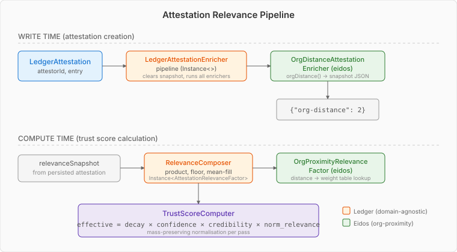
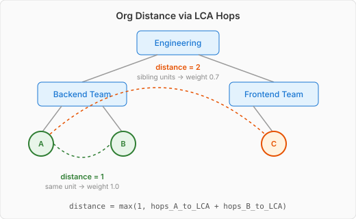

# Whose Evidence Matters

A trust score is only as good as the evidence behind it. In a multi-agent system where agents attest to each other's work, the natural question is: whose attestation should carry the most weight?

Two agents in the same organisational unit share operational context — the same tools, the same domain knowledge, the same calibration from working the same cases. That shared context makes their judgments more *informed*. A code reviewer in your team has seen the codebase; a reviewer three departments away hasn't.

But shared context also means shared biases. Same-unit agents correlate. They've trained on the same data, they follow the same conventions, they may even share the same blind spots. Cross-unit attestations are less informed but more *independent*.

This is a real tension, and it doesn't have one right answer. The design I landed today picks a side — accuracy over independence — and makes it configurable.

## The Factor Pipeline

The key design constraint was that the ledger must stay domain-agnostic. The ledger knows about attestations, trust scores, and the weight chain that combines them. It does not know about org structure, teams, or units. Those are eidos concepts.

The spec introduced two SPIs in the ledger:

- `AttestationRelevanceFactor` — given an attestation's context, return a weight in [0.0, 1.0]
- `LedgerAttestationEnricher` — at write time, stamp data into the attestation that factors will read later

The `RelevanceComposer` in ledger-core discovers all `AttestationRelevanceFactor` beans on the classpath, multiplies their weights (floored at a configurable minimum to prevent compounding to near-zero), and feeds the result into the trust computation pipeline. With zero factors, everything is NEUTRAL — backward-compatible, no behaviour change.

Eidos provides the first factor: org-proximity.



## Write-Time Snapshots

The distance between two agents in the org hierarchy isn't a fixed property — it changes when agents move units, when units reorganise, when new reporting lines appear. If I computed distance at trust-score time, an org reorg would retroactively rewrite the trust history. An attestation that was same-unit when it was written would suddenly look cross-unit, and its influence would drop.

That's wrong. The relationship that matters is the one that existed when the attestation was made. So the enricher captures distance at write time, and the factor reads it from the attestation's snapshot — never from the live org structure.

This follows the precedent set by ADR 0005 ("Group Membership Snapshot at WorkItem Creation"): exclusion must be deterministic, provider calls must not multiply latency, and the audit trail must explain the result.

It also gives consistency across all three `TrustScoreSource` strategies (Materialized, Cached, Computed). Without the snapshot, different strategies could disagree after an org change — same evidence, different scores.

## Distance as LCA Hops

Eidos already has `OrgAwareDispatch.orgDistance()` from earlier work on dispatch routing. It computes the Lowest Common Ancestor distance between two agents in the org tree:



The formula is `max(1, i + j)` where `i` and `j` are ancestor-chain positions. Distance 1 covers both same-unit and direct parent/child. Distance 0 means same agent (self-attestation), which the trust pipeline already excludes from Beta computation.

The `OrgDistanceAttestationEnricher` calls `orgDistance()` with the raw, pre-tokenised identities. This is critical — tokenised IDs are opaque and would return -1 from the distance calculation. The enricher pipeline runs before tokenisation specifically for this reason.

```java
int distance = orgAwareDispatch.orgDistance(
        attestation.attestorId, entry.actorId, entry.tenancyId);

if (distance < 0) {
    return;  // unknown/disconnected — leave snapshot null
}
```

When distance is -1 (agents have no common org structure), the enricher does nothing. The attestation's snapshot stays null, and the factor returns NEUTRAL. No org structure means equal weighting — a sensible default.

## The Weight Table

`OrgProximityRelevanceFactor` reads `"org-distance"` from the snapshot and maps it through a configurable distance-indexed table:

| Distance | Meaning | Default weight |
|----------|---------|----------------|
| 1 | Same unit or direct parent/child | 1.0 |
| 2 | Sibling units or grandparent/grandchild | 0.7 |
| 3 | Three LCA hops | 0.65 |
| 4+ | Distant (last entry repeats) | 0.6 |

The defaults are accuracy-biased: same-unit attestors get full weight, distant attestors get 60%. The table is a `@ConfigProperty` — consumers can flatten it, invert it, or tune it per deployment.

```properties
casehub.eidos.trust.relevance.weights=1.0,0.7,0.65,0.6
```

## Mass-Preserving Normalisation

Here's the subtlety that makes relevance weighting correct rather than merely plausible.

If I just multiply every attestation's weight by a relevance factor, I shrink the total evidence mass. Fewer effective observations means the Beta distribution pulls toward the 0.5 prior. An agent with twenty high-quality attestations would get a *worse* trust score than the same agent with no relevance weighting at all — purely because discounting cross-unit evidence reduced the total mass.

The fix is mass-preserving normalisation. After computing raw relevance weights, `TrustScoreComputer` normalises per pass so the total weighted evidence mass equals what it would have been without relevance. The normalisation factor is:

```
normFactor = sum(decay × confidence × credibility) / sum(decay × confidence × credibility × relevance)
```

Each attestation's effective relevance becomes `rawRelevance × normFactor`. Above-mean attestations get effective weights above 1.0 — that's by design.

The result: relevance changes *whose* evidence dominates within a pass, never *how much* evidence exists. Same-unit attestors' judgments carry more influence relative to cross-unit attestors, but the total evidence mass stays constant.

## A Defensive Catch

During code review, Claude flagged a cast in the factor that would throw `ClassCastException` if the snapshot value was not a `Number`. The enricher writes integers, so under normal operation the cast is safe. But the factor sits on the trust computation hot path — if a corrupted snapshot somehow contains a string, the entire trust computation for that pass would fail.

The fix was three lines:

```java
Object raw = snapshot.get(SNAPSHOT_KEY);
if (!(raw instanceof Number)) {
    return RelevanceAssessment.NEUTRAL;
}
int distance = ((Number) raw).intValue();
```

Defensive, not paranoid. The enricher is the only writer, but the factor shouldn't assume it's the only possible writer forever.

## What This Opens Up

The factor pipeline is designed for composition. The org-proximity factor is the first, but the SPI supports any number of factors — their weights multiply. Future candidates:

- **Independence-aware factor** — cap same-unit evidence share to prevent in-unit amplification. This would address the anti-gaming gap: a unit of agents whose positive attestations correlate producing artificially high trust scores.
- **Capability-overlap factor** — an attestor whose declared capabilities overlap with the scored agent's capability may have more relevant judgment than one operating in a different domain.
- **Collaboration-recency factor** — agents that recently collaborated on the same work item have fresher context.

Each new factor needs only a new enricher (to stamp write-time data) and a new factor bean (to read it). No ledger schema changes, no changes to any existing factor.

The floor in `RelevanceComposer` prevents compounding from driving weights to near-zero when multiple factors apply — without it, three independent factors each at 0.6 would compound to 0.216, which is aggressive enough to effectively ignore distant attestations.
