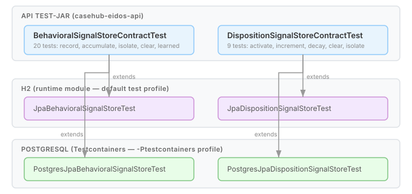

# Three Gaps Past Green

The previous session landed dialect-aware upsert for all three JPA signal stores — PostgreSQL's `INSERT ... ON CONFLICT DO UPDATE` instead of SQL `MERGE`, verified with Testcontainers. Every test passed. The SQL was syntactically correct, the dialect detection worked, the upsert incremented on conflict exactly as written. Green across the board.

The problem with green is that it only means the things you tested are correct. Three gaps remained, each invisible from the perspective of the tests that existed.

## Gap 1: Concurrent correctness

The existing tests called `store.record()` sequentially. One thread, one transaction, one row at a time. This is the happy path that every upsert is designed for.

Production is not sequential. Two agents report a DECLINE signal for the same capability at the same moment. Two threads hit the same composite primary key — `(agent_id, tenancy_id, capability_name, qualifier, signal_type)` — and both attempt the INSERT path before either commits. PostgreSQL's `ON CONFLICT` handles this atomically in most cases, but under heavy contention, transient errors surface: `23505` (unique_violation) when two transactions race past the conflict check, `40P01` (deadlock) when lock ordering disagrees, `40001` (serialization failure) when the isolation level is strict enough.

The right response is not to prevent these errors. They are a normal part of concurrent database access. The right response is application-level retry — catch the transient error, activate a fresh CDI request context (the old EntityManager is in an undefined state after a rolled-back transaction), and try again.

The concurrent test spawns ten virtual threads, each recording ten signals to the same primary key. Every call goes through a retry wrapper that activates a CDI request context, runs the store method, and catches transient PostgreSQL errors:

```java
private void retryOnContention(Runnable action) {
    for (int attempt = 1; attempt <= MAX_RETRIES; attempt++) {
        var ctx = Arc.container().requestContext();
        ctx.activate();
        try {
            action.run();
            return;
        } catch (Exception e) {
            if (attempt == MAX_RETRIES || !isTransientPostgresError(e))
                throw e instanceof RuntimeException re ? re : new RuntimeException(e);
        } finally {
            ctx.deactivate();
        }
    }
}
```

The assertion is simple: after all threads complete, the final count must equal `THREADS × RECORDS_PER_THREAD`. No data lost, no double-counts, no silent failures. If the upsert is not atomic, the count will drift. If the retry logic swallows non-transient errors, the failure counter will be non-zero.

This covers all three stores. The behavioral and disposition stores accumulate — the final count is the sum. The agent state store replaces — the final state is the last value written. Both accumulation and replacement need to survive contention.

## Gap 2: Contract consistency

The `AgentStateStore` already had contract tests — an abstract `AgentStateStoreContractTest` in the api test-jar, extended by both the H2 and PostgreSQL subclasses. Zero duplicated test logic. When the PostgreSQL test class extends the contract, it inherits every scenario and runs them against a real database.

The behavioral and disposition stores had no contract tests. Each JPA implementation had its own inline test methods, and the PostgreSQL variants had a subset of those methods — sometimes with different names, sometimes testing slightly different things. The same behaviour was verified in two places with no guarantee of consistency.

Extracting the contract tests follows the same pattern. `BehavioralSignalStoreContractTest` defines twenty test methods — single-signal recording, accumulation, isolation by agent and tenancy, cross-signal independence, clear semantics, learned-domain queries. `DispositionSignalStoreContractTest` defines nine — activation, increment, decay, clear, isolation. The JPA subclasses collapse to `store()` override and cleanup:

```java
@QuarkusTest
class JpaBehavioralSignalStoreTest extends BehavioralSignalStoreContractTest {

    @Inject BehavioralSignalStore store;
    @Inject EntityManager em;

    @Override
    protected BehavioralSignalStore store() { return store; }

    @BeforeEach @Override @Transactional
    protected void resetStore() {
        em.createNativeQuery("DELETE FROM behavioral_signal").executeUpdate();
    }
}
```

The PostgreSQL behavioral store now runs twenty tests instead of five. The disposition store runs nine instead of six. The tests that the PostgreSQL variants were missing — `clear_code_review_does_not_remove_code_review_enhanced`, `decline_and_success_coexist_independently`, `learned_returns_violated_qualifiers` — are exactly the kind of edge cases that dialect differences can break silently.

One discovery during extraction: Quarkus's `@TestTransaction` does not wrap inherited `@Test` methods from a superclass. Each inherited test method runs without a transaction boundary, so data committed by one test leaks into the next. The fix is explicit `@BeforeEach` cleanup in every subclass — the same pattern the disposition store already needed because its `recordActivation()` uses `TxType.REQUIRES_NEW`.



## Gap 3: CDI wiring

`OrgProximityRelevanceFactor` and `OrgDistanceAttestationEnricher` are `@ApplicationScoped` beans in the org-runtime module. They implement ledger SPIs — `AttestationRelevanceFactor` and `LedgerAttestationEnricher` — and depend on cross-module injection: config property lists, `OrgAwareDispatch` (which depends on `OrgRegistry`, `AgentRegistry`, and `CapabilityHealth`).

The existing tests were pure unit tests with direct construction and mocks. They verified the logic perfectly. They did not verify that CDI could wire the beans at all. Config property injection for `List<Double>` from a comma-separated string? Works in production, never tested. `DefaultOrgAwareDispatch` winning over `NoOpOrgAwareDispatch` when org-runtime is on the classpath? Assumed, never verified.

The CDI test is four assertions: the relevance factor is wired and receives default config weights, the enricher is wired as a `LedgerAttestationEnricher`, `OrgAwareDispatch` resolves to `DefaultOrgAwareDispatch`, and nobody throws `UnsatisfiedResolutionException`. Stub beans for `AgentRegistry` and `CapabilityHealth` satisfy the dependency chain without dragging in the full eidos runtime.

If any of these wiring assumptions are wrong — a missing `@DefaultBean`, an ambiguous alternative, a config key typo — the test fails at application startup before any assertion runs. That is the entire point.

## What green actually means now

Before this session: green meant the SQL was correct on both dialects.

After: green means the SQL is correct under concurrent load with retry, the same contract is verified on both dialects with identical scenarios, and the CDI wiring resolves without ambiguity. Three different classes of failure — data races, dialect-specific edge cases, and dependency injection errors — that were invisible to the test suite and are now covered.

The progression is worth naming because it recurs. Every layer of verification catches a different kind of bug, and each layer looks unnecessary from the perspective of the layer below it. Sequential tests see no need for concurrent tests. Inline tests see no need for contract tests. Unit tests see no need for CDI tests. The gaps are always between the layers, in the interactions the simpler test cannot observe
