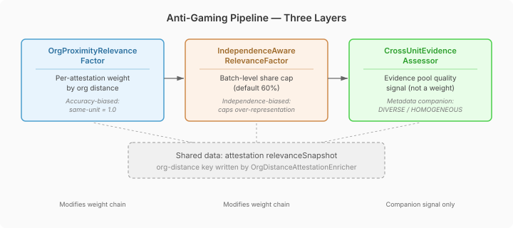

# When Confidence Lies

A trust score of 0.85 with a narrow confidence interval looks solid. Twenty attestations, mostly positive, strong Bayesian posterior. The engine dispatches work to this agent without hesitation.

But if all twenty attestations came from the same organisational unit, the confidence interval is a statistical illusion. It measures sampling variance — how much the score would change if you drew a different sample from the same population. It does not measure systematic bias. Those twenty attestors share operational context, tools, training data, and social incentives. Their judgments aren't twenty independent signals. They're the same signal, observed twenty times.

This is the precision-versus-accuracy distinction from measurement theory. A thermometer that consistently reads 2°C too high gives you very precise readings — narrow error bars, highly reproducible. But the readings are wrong. Cross-unit evidence is the calibration check.

## Why a Relevance Factor Can't Fix This

The first instinct was to build another `AttestationRelevanceFactor` — the same SPI the independence cap uses. Penalise all attestations in a pure-same-unit batch, and the score drops to reflect the homogeneous evidence.

It doesn't work. The trust pipeline uses mass-preserving normalisation: relevance changes *whose* evidence dominates within a computation pass, never *how much* evidence exists. If you uniformly discount every attestation by the same factor, normalisation rescales everything back. The total evidence mass is preserved by design. The score doesn't change.

This isn't a bug. Mass preservation is the right behaviour for attestation weighting — without it, any uniform discount pulls Beta scores toward the 0.5 prior, which is worse than the problem it's solving. But it means the relevance factor pipeline is the wrong tool for evidence pool quality. A factor answers "how much should this attestation weigh relative to its peers?" Evidence diversity answers "how trustworthy is the evidence pool as a whole?" These are orthogonal questions.

## A Separate Signal Path

The answer is a standalone assessor — a CDI bean that takes the attestation snapshots (the same `org-distance` data the relevance factors already read) and returns a typed diversity assessment. Not a modified score. Not a weight adjustment. A companion signal that tells the consumer: this score has been independently validated, or it hasn't.

```java
public interface CrossUnitEvidenceAssessor {
    CrossUnitEvidenceAssessment assess(List<Map<String, Object>> snapshots);
}
```

The assessment carries counts (same-unit, cross-unit, unknown) and a level: `DIVERSE` when cross-unit attestation count meets the threshold, `HOMOGENEOUS` when it doesn't, `UNKNOWN` when no org structure data exists. The threshold is configurable — default is 2, because one cross-unit attestation is noise, but two starts to look like a pattern.

The input is `List<Map<String, Object>>` — raw attestation snapshots with no dependency on ledger types. The engine extracts snapshots from the attestations it already has and passes them. Zero ledger changes.

## The Utility Extraction

Building the assessor surfaced a refactoring opportunity. Both `OrgProximityRelevanceFactor` and `IndependenceAwareRelevanceFactor` had their own private `extractDistance()` methods — identical logic for reading `org-distance` from a snapshot map. And `OrgProximityRelevanceFactor` owned the `SNAPSHOT_KEY` constant that `OrgDistanceAttestationEnricher` referenced.

We extracted `OrgDistanceUtil` as a shared utility in `org-runtime`. One method, one constant, three consumers. The kind of cleanup that only becomes obvious when a third user of the same logic arrives.

## Where This Sits

The anti-gaming pipeline now has three layers, each addressing a different concern:



**OrgProximityRelevanceFactor** answers: given this attestor's organisational distance from the scored agent, how much weight should this attestation carry? Accuracy-biased — same-unit gets full weight because shared context makes judgments more informed.

**IndependenceAwareRelevanceFactor** answers: is the same-unit share of this group's evidence too high? If same-unit attestations exceed 60% of the group, it caps their weights — a batch-aware correction that only fires when the composition is skewed.

**CrossUnitEvidenceAssessor** answers: has this score been validated by any independent observer at all? Not a weight adjustment — a metadata signal. A score with zero cross-unit evidence might be perfectly accurate, but we can't know that without at least one independent data point.

The three compose: proximity weights individual attestations, independence caps batch-level over-representation, and the assessor flags evidence pools that lack any external validation. Each SPI operates independently through the CDI discovery mechanism. Adding or removing any one doesn't affect the others.

The pattern here is worth noting. The `@DefaultBean` NoOp in `eidos-core` returns `UNKNOWN` for everything — backward-compatible when the org module isn't on the classpath. The `@ApplicationScoped` implementation in `org-runtime` displaces it. Same CDI priority ladder as `NoOpOrgAwareDispatch`, `NoOpBehavioralSignalStore`, and every other optional-module SPI in eidos. A consumer that doesn't care about org-distance evidence diversity pays nothing for its existence.

What comes next is wiring the assessor into engine dispatch. The engine already integrates trust scores with capability health probes — the diversity assessment slots in alongside those signals. That's engine work, not eidos work. The SPI boundary is clean.
