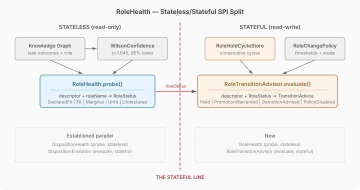

# The Stateful Line

CapabilityHealth answers "can this agent do X right now?" DispositionHealth answers "is this agent's personality drifting?" The missing probe was for roles: "is this agent fit to serve as coordinator?" RoleChangePolicy already defined the thresholds — `minConfidence`, `demotionConfidence`, `minHoldCycles` — but nothing produced the confidence values those thresholds compared against. The governance existed. The evidence didn't.

The obvious design was to mirror CapabilityHealth directly. One SPI, one probe method, one sealed result. I started there. But `minHoldCycles` broke the analogy.

## Where Fitness Ends and Policy Begins

CapabilityHealth.probe() is stateless. It reads signals, computes a status, returns. Call it a thousand times with the same inputs and you get the same answer. The probe has no side effects. This is a good property — it means any consumer can probe at any time for any reason without worrying about corrupting shared state.

RoleChangePolicy's hold-cycle mechanism can't work that way. `minHoldCycles` says: don't advise demotion until the agent has been unfit for N consecutive evaluation cycles. "Consecutive" is the problem — it requires a persistent counter per (agentId, roleName) that increments on each unfit evaluation and resets when fitness recovers. The probe would need to write state on every call.

This is the stateful line. Everything on one side of it is a pure function of current evidence. Everything on the other side tracks history across calls. The design question was where to draw it.

The existing codebase already answered this. DispositionHealth is a stateless probe — it computes effective weights and returns Aligned, Drifted, or EvolutionPending. DispositionEvolution is the stateful counterpart — it evaluates whether a pending evolution should proceed and manages signal decay. Two SPIs, one read-only, one read-write.

RoleHealth follows the same split. `RoleHealth.probe()` reads task outcomes, computes Wilson confidence, returns a sealed `RoleStatus`. `RoleTransitionAdvisor.evaluate()` reads the policy, tracks hold-cycles, and returns `TransitionAdvice`. The probe is always safe to call. The advisor has side effects, and that's visible in the type system.

## Why Not a Signal Store?

My first instinct was a dedicated `RoleSignalStore` — a third signal store alongside `BehavioralSignalStore` and `DispositionSignalStore`. Consumers would record SUCCESS, STRUGGLE, DECLINE signals when they observed role behaviour. The probe would aggregate those signals into confidence.

The decision review pushed back on this. The knowledge graph already records per-agent task outcomes with attestation chains and Wilson scoring infrastructure. Adding a `role` field to `AgentTask` — one field, one column — gives the probe everything it needs without introducing a new SPI, a new CDI ladder, and a new recording protocol.

The difference is objectivity. Task outcomes are facts: the agent was dispatched in this role, the task succeeded or failed. Signal stores are opinions: someone decided to record SUCCESS or STRUGGLE. For trust-critical routing decisions, evidence from objective outcomes is stronger than evidence from subjective assessments. The knowledge graph's attestation chains provide auditability that ad-hoc signal recording can't match.

## Beta-Binomial vs Wilson

I initially proposed a Beta-Binomial posterior mean for confidence computation. Alpha accumulates positive evidence, beta accumulates negative, the posterior mean is α/(α+β). It handles sparse data gracefully — the conjugate prior gives sensible answers with just a few observations.

Then we checked ARC42STORIES.MD §1. The platform's quality goals specify Wilson lower-bound confidence scoring. `AgentGraphQuery.topAgentsByOutcome()` already uses Wilson at z=1.645. The Wilson lower-bound is intentionally conservative — it penalises small samples rather than giving them the benefit of the doubt.

This is the right choice for role transitions. The posterior mean for 2 successes out of 2 observations is 0.75 (with a uniform prior). Wilson lower-bound for the same data is ~0.21. If `minConfidence` is 0.5, the Beta-Binomial says the agent is fit; Wilson says there isn't enough evidence to be confident. For safety-critical role changes where false positives (premature promotion) are more costly than false negatives (delayed promotion), conservatism is correct.

The practical implementation: `WilsonConfidence.score()` is now a public utility in api/, extracted from the package-private static method in `JpaAgentGraphQuery`. Both the existing agent ranking and the new role health probe share the same computation.

## What's Next

The API types are in place. Task 1 of the implementation is done — WilsonConfidence extracted, Mode.DISABLED added to RoleChangePolicy. The remaining five tasks build the probe implementation, hold-cycle store, transition advisor, CDI wiring, and integration tests. The design spec covers the full surface; the implementation plan breaks it into two batches with safe wrap points between them.

The interesting open question is what happens when stigmergy arrives. The issue references DetectedRole and behavioural signals as future evidence sources — emergent role detection from observed patterns rather than explicit task outcomes. When that infrastructure exists, `DefaultRoleHealth` can integrate it as supplementary evidence alongside task outcomes, without changing the SPI. The probe's signature doesn't care where the evidence comes from; it cares about the confidence that comes out.
