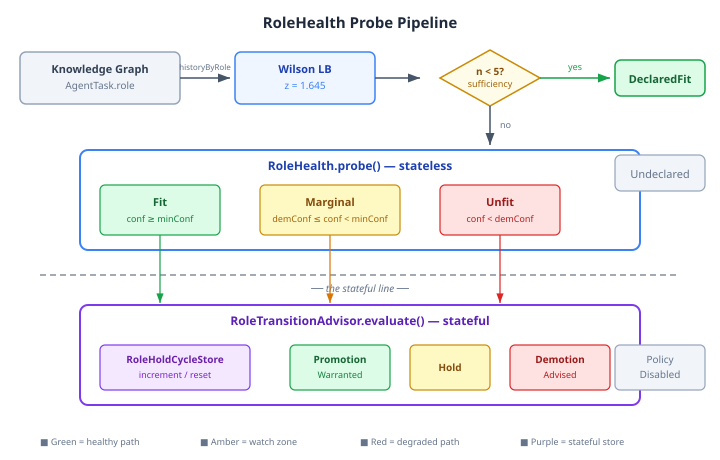

# When the Design Meets Reality

Continuing from [The Stateful Line](2026-11-24-mdp02-the-stateful-line.md), which covered the design decisions behind the RoleHealth two-SPI split. This session built the whole thing — five tasks from AgentTask's new `role` field through to Quarkus integration tests.

The design spec had eight decisions. The interesting part is which ones survived implementation unchanged, which needed adjustment, and what the tests revealed that the spec didn't anticipate.

## The Constructor Ripple

Adding `role` to `AgentTask` is a one-line change to a record declaration. It broke 14 constructor calls across 3 files. Java records enforce this — every call site must pass every field in order, so a new field in position 6 means 14 edits to insert `null` at the right spot. No silent defaults, no optional parameters, no way to miss one.

This is the kind of mechanical cost that makes developers hesitate before adding fields to widely-used records. But the alternative — a builder pattern for a data carrier — trades compile-time safety for runtime ambiguity. I'll take the 14 edits.

The schema migration was cleaner than expected. One `ALTER TABLE ADD COLUMN`, one composite index, and the `role_hold_cycle` table for the transition advisor's state. The `role_hold_cycle` table uses a natural composite key `(agent_id, tenancy_id, role_name)` rather than a surrogate. For a table that's essentially a counter with a timestamp, a surrogate key would be overhead with no benefit.

## What Wilson Actually Returns

The design spec said to use Wilson lower-bound confidence at z=1.645, matching the existing `topAgentsByOutcome` scoring. The implementation confirmed this was right, but the marginal test exposed something I hadn't thought through.

My first test for the Marginal status used 10 PARTIALLY-succeeded outcomes with confidence 0.9. Each partial success contributes quality = 0.5 × 0.9 = 0.45. Wilson lower-bound for p=0.45 with n=10 gives approximately 0.23. I'd set `demotionConfidence` at 0.3 — so the score was actually *below* demotion, not marginal at all.

Wilson punishes small samples hard. The gap between raw proportion and Wilson lower bound shrinks as sample size grows — 20 successful observations at confidence 0.7 gives a Wilson score around 0.52, comfortably in the marginal band between 0.3 and 0.8. The lesson: when setting policy thresholds, think in Wilson scores, not raw success rates. A `minConfidence` of 0.7 doesn't mean "70% success rate" — it means "95% statistical confidence that the true success rate exceeds 70%," which requires substantially more evidence.

## Data Sufficiency as an Explicit Gate

The probe returns `DeclaredFit` — not `Fit` — when there are fewer than 5 task outcomes. This reuses `GraphDataSufficiency.forCount()` which already classifies counts into INSUFFICIENT (< 5), INDICATIVE (5–9), and SUFFICIENT (≥ 10).

The naming matters. `DeclaredFit` says "this agent claims to fill this role and we have no evidence to the contrary." `Fit` says "we have evidence and it's good." A consumer that needs high confidence can distinguish the two. A consumer that just needs "not unfit" can treat both as passing.

This is the same principle behind innocent-until-proven-guilty in law: absence of negative evidence is not evidence of fitness, but it's not grounds for exclusion either. The agent declared the role; the system hasn't yet observed enough to confirm or deny.

## The CDI Ladder

Three new SPIs (`RoleHealth`, `RoleTransitionAdvisor`, `RoleHoldCycleStore`) means three new NoOp classes and three new `@Produces @DefaultBean` methods in `EidosCoreProducer`. The pattern is established — `EidosCoreProducer` now has 21 fallback producers, each returning a NoOp implementation so that apps that only depend on `casehub-eidos` (without the graph or memory modules) get a working CDI container.

The active implementations slot in by priority: `DefaultRoleHealth` and `DefaultRoleTransitionAdvisor` are `@ApplicationScoped` in the runtime module. `InMemoryRoleHoldCycleStore` is `@Alternative @Priority(1)` in persistence-memory, displacing the NoOp when the memory module is on the classpath.

## What the Spec Didn't Cover

The code review caught a gap the spec missed: there was no JPA integration test for `historyByRole`. Every other method on `AgentGraphQuery` had one — role filtering, temporal window, tenancy isolation, ordering. The JPQL was correct (it matched the existing `historyByCapability` pattern), but untested JPQL is a liability. Four integration tests now cover role filtering, temporal window enforcement, tenancy isolation, and descending order.

The spec also didn't anticipate that `NoOpAgentGraphQuery` needed the new method. Adding `historyByRole` to the interface broke compilation in `eidos-core` — a module the spec's file list didn't mention. Interface changes ripple further than record changes because they require method implementations, not just constructor arguments.
