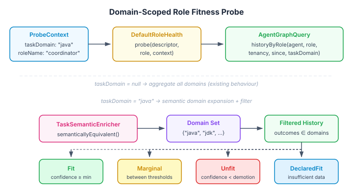

# Domain-Scoped Role Fitness

The RoleHealth probe we built in #271 computes aggregate role confidence — it answers "is this agent a good coordinator?" but can't distinguish "good coordinator *for Java projects*" from "good coordinator *for Python projects*." The knowledge graph already stores `taskDomain` on every task record. We just weren't using it.

The fix threads `ProbeContext.taskDomain` through the entire query path. When the domain is null, the probe aggregates across all domains — identical to the previous behaviour. When a domain is specified, the JPA layer expands it to semantically equivalent domains via `TaskSemanticEnricher` and filters the history to that set before computing Wilson confidence.

This follows the exact pattern that `topAgentsByOutcome` already uses for domain-scoped agent ranking. The semantic expansion matters because domain names aren't standardised — "java" and "jdk" might refer to the same thing, and the enricher is where that equivalence lives.

The API change is a default method on `AgentGraphQuery`, so every existing implementation gets the aggregate-fallback behaviour for free. Only `JpaAgentGraphQuery` overrides it to add the domain filter. The change to `DefaultRoleHealth` itself was a single line — passing `context.taskDomain()` where it previously passed nothing.

What this opens up: the engine can now make smarter dispatch decisions based on domain-specific track records. An agent that's a strong coordinator for infrastructure work but consistently underperforms on data-pipeline coordination will get different role fitness scores depending on what the task actually is. The aggregate score was always a lossy compression of that signal — now consumers can choose the resolution they need.
