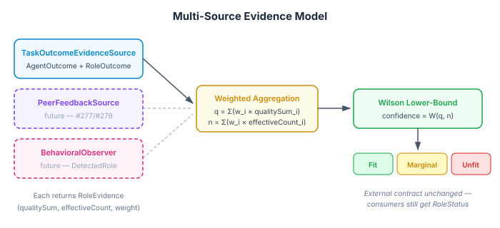

# Multi-Source Role Evidence

The RoleHealth probe we built in #271 had a known blind spot: it measured task success, not role-specific performance. An agent can coordinate poorly while the analysts carry the work to a successful outcome. The task succeeds, the coordinator's confidence score goes up, and the probe lies.

The fix sounds simple — add more evidence sources. But the design question is structural: should multiple sources blend into one score, or stay separate? We went to the literature.

Three findings converged. Scullen, Mount & Goff (2000) decomposed variance in multi-source performance ratings and found 53-62% comes from individual rater idiosyncrasy — collapsing sources destroys the signal about which source is reliable. A 2026 study on evaluation design found an "interior optimum" where a limited number of dimensions captures most informational content — not one blended score, not a fully granular battery. And Wang & Singh's evidence-based trust model (2010) showed that counting positive/negative experiences with principled uncertainty outperforms heuristic aggregation.

The result is a hybrid: internally multi-layer (each evidence source carries its own quality sum and confidence), externally single-status (the probe still returns Fit/Marginal/Unfit). Source identity is preserved for diagnostics. The consumer contract is unchanged.

The SPI is `RoleEvidenceSource` — CDI-discovered, following the same `Instance<>` pattern as `VocabularyRegistrar` and `PromptContributor`. Each source returns `RoleEvidence(qualitySum, effectiveCount, weight)`. The probe aggregates via weighted sums and runs Wilson lower-bound on the totals.

One detail that the spec review caught: the original design used binary positive/negative counts (following the beta reputation model), but this would break backward compatibility. The existing probe uses continuous quality values — `confidence × multiplier(result)` with temporal decay producing fractional contributions. Binary classification would have made every PARTIALLY-succeeded task negative, changing probe results materially. We switched to continuous `(qualitySum, effectiveCount)` pairs, which preserve the existing probe's math exactly when only one source exists.

The first concrete source, `TaskOutcomeEvidenceSource`, extracts the existing probe logic and adds `RoleOutcome` preference: when the engine records a role-specific quality score alongside the task outcome, that score takes precedence. Without a `RoleOutcome`, it falls back to the task-level quality — backward-compatible by design.

Peer feedback and behavioral observation plug in later as additional `RoleEvidenceSource` beans. No probe changes needed — just a new CDI bean and the probe discovers it.
