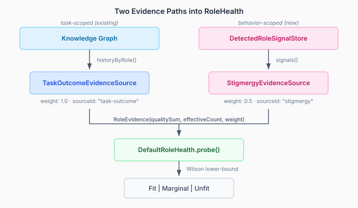

# Behavior-Scoped Evidence

The multi-source RoleHealth architecture we built in #273 was designed for exactly this moment. `TaskOutcomeEvidenceSource` answers "did the agent succeed at tasks while in this role?" But success at tasks is not the same thing as performing the role. An agent can coordinate — delegating, mediating conflicts, initiating reviews — without any of those behaviors showing up as a task outcome. The coordination is real. The evidence pipeline can't see it.

Stigmergy is the biological term for this: coordination through environmental signals rather than direct communication. Ants don't report to a coordinator; they leave pheromone trails that other ants follow. The pattern emerges from accumulated behavior, not explicit assignment.

The design question that shaped the whole implementation was scope. `RoleOutcome` — the existing per-task quality observation — requires a `taskId`. It's the entity's primary key. Stigmergy signals don't have that constraint. "Agent X has been coordinating lately" is an observation about a behavioral pattern, not about a specific task. It might span dozens of tasks, or derive from aggregate patterns that no single task captures. This is a structural mismatch, not a naming difference.

The store SPI ended up thin by design: `record()`, `signals()`, `signalsByAgent()`, `purge()`, `clear()`. All aggregation — temporal decay, Wilson scoring, threshold filtering — lives in eidos-runtime. The store is a dumb pipe. Engine records what it observes; eidos decides what it means. This is the same separation that makes `BehavioralSignalStore` work for capability health, and it means the store implementation can live anywhere — engine, claudony, an application-tier app that observes domain-specific delegation patterns.

Each signal carries a `patternType` as an open string — "delegation", "review-initiation", "conflict-mediation" — with optional vocabulary grounding. I considered a fixed enum and rejected it. We don't know what behavioral patterns will emerge from real observation. Creating a hierarchy for unknown patterns is the kind of premature abstraction that becomes load-bearing before anyone notices.

The evidence source weights stigmergy at 0.5 against task outcomes at 1.0. When both sources have equal effective counts, task outcomes contribute roughly two-thirds and stigmergy one-third. The weighting is configurable, but the default reflects a deliberate asymmetry: observed behavior is suggestive, measured outcomes are definitive. As the stigmergy signal model matures and we learn which patterns are reliable, the weight can shift.

What I find most interesting is the dual-purpose read. The same signals feed two consumers: `StigmergyEvidenceSource` answers "how well is this agent performing its declared coordinator role?" (evidence for the probe), while `DetectedRoleQuery` answers "what roles is this agent actually performing?" (role discovery). Same data, different questions. The discovery path enables something the declared role model can't: finding agents who are performing roles nobody assigned them.